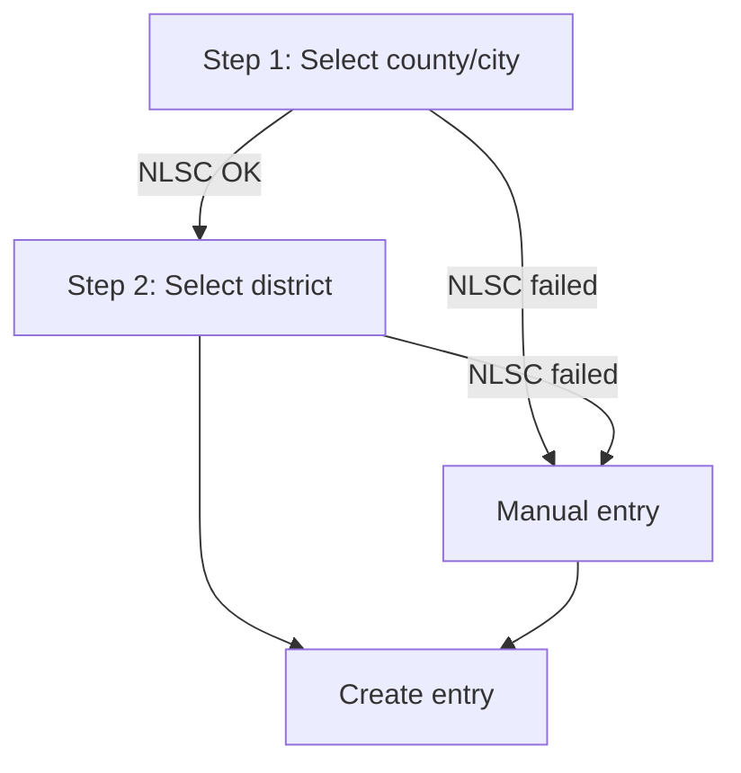
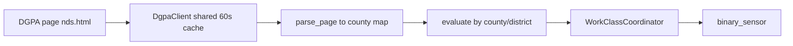

<p align="left">
  
</p>

# Taiwan Work and School Suspension – Home Assistant Custom Integration

English | [繁體中文](README_Chinese.md)

Scrapes the latest announcements from the **Directorate-General of Personnel Administration (DGPA)** page "[Natural Disaster Work and Class Suspension Status](https://www.dgpa.gov.tw/typh/daily/nds.html)" and creates one `binary_sensor` per location you care about (a whole county/city, or a single district), so you can build automations during typhoons and heavy rain.

| Item | Value |
| --- | --- |
| Domain | `tw_suspension` |
| Integration type | `service` (`cloud_polling`) |
| Platform | `binary_sensor` |
| Minimum HA version | 2024.11.0 |
| Requirements | `beautifulsoup4>=4.12.0` (installed automatically by HA) |
| Version | 0.1.0 |

---

## Features

- **One sensor per location**: monitor a whole county/city or a specific district.
- **Dropdown location picker**: county/district lists are fetched live from the **NLSC (National Land Surveying and Mapping Center) code service API**; falls back to manual entry if the API fails.
- **Smart matching**: `台` / `臺` spellings are unified automatically. If you pick a district but the announcement only covers the county level, it falls back to the county-wide or "其他地區" (other areas) announcement.
- **Partial-time detection**: when the text contains words like 上午 / 下午 / 晚上 / 夜間 / 中午, `X 時` or `HH:MM`, the `partial` attribute is `true`.
- **Shared cache**: all locations share one copy of the page (cached for 60 s) to avoid hammering the government site.
- **Fault tolerant**: on a failed refresh the last known state is kept instead of turning `unavailable`.
- **Configurable interval and SSL verification** via the integration options; the entry reloads automatically after changes.
- **Bilingual UI**: built-in `zh-Hant` and `en` translations.

---

## Installation

### Option 1: HACS (recommended)

1. HACS → top-right "⋮" → **Custom repositories**.
2. Paste this repository URL and choose category **Integration**.
3. Search for "Taiwan Work and School Suspension" and download it.
4. Restart Home Assistant.

### Option 2: Manual

1. Copy the whole `custom_components/tw_suspension` folder into `/config/custom_components/`.
2. Restart Home Assistant.

---

## Configuration

Go to **Settings → Devices & Services → Add Integration** and search for **Taiwan Work and School Suspension**.

### Config flow



1. **Select county/city** from the dropdown.
2. **Select district**:
   - whole county/city: use the county-wide announcement (see evaluation logic below).
   - A specific district: only that district's announcement is used.
3. **Manual entry (fallback)**: if the NLSC list cannot be loaded, the error is shown and you can type the names manually. Names must match the DGPA page; district may be empty.

> [!NOTE]
> - Add the integration once per location.
> - Each "county + district" pair can only be configured once (unique ID is `county|district`); duplicates abort with "already configured".
> - The entry title is county + district, e.g. `臺北市` or `新北市板橋區`.

### Options (after setup)

Click **Configure** on the integration card:

| Option | Default | Range | Description |
| --- | --- | --- | --- |
| Update interval (minutes) `scan_interval` | `30` | 10 – 1440 | How often to fetch the DGPA page |
| Verify SSL certificate `verify_ssl` | `false` | on / off | The DGPA certificate lacks a Subject Key Identifier and fails strict verification, so it is off by default |

Saving the options reloads the entry automatically.

---

## Entities

Each entry creates one device (type "service", manufacturer "行政院人事行政總處 (DGPA)") with one binary sensor.

- **Entity name**: `Work/class suspension` (`停班停課` in Traditional Chinese UI)
- **Entity ID example**: `binary_sensor.<title>_ting_ban_ting_ke` or `binary_sensor.<title>_work_class_suspension` depending on the UI language at creation time — check the entity list for the actual ID.

### State

| State | Condition | Icon |
| --- | --- | --- |
| `on` | `work_stopped` **or** `class_stopped` is `true` | `mdi:cloud-alert` |
| `off` | Neither work nor class is suspended | `mdi:cloud` |
| `unavailable` | Data has never been fetched successfully | — |

### Attributes

| Attribute | Type | Description |
| --- | --- | --- |
| `work_stopped` | bool | Text contains "停止上班" (work suspended) |
| `class_stopped` | bool | Text contains "停止上課" (class suspended) |
| `partial` | bool | Suspension applies only to part of the day (e.g. "下午停止上班"); in whole-county aggregate mode it is `true` whenever any district is suspended |
| `raw` | str | The matched raw announcement text |
| `city` | str | Configured county/city (normalized to `臺`) |
| `district` | str | Configured district (empty string for whole county) |
| `last_updated` | str | Last successful update time (ISO 8601 with timezone, seconds precision) |

---

## How It Works



### 1. Fetching ([api.py](custom_components/tw_suspension/api.py))

- Fetches the DGPA page with `aiohttp`, 10 s timeout.
- Decodes as UTF-8, falling back to Big5.
- All entries share one `DgpaClient` (keyed by the `verify_ssl` setting), protected by a lock and a 60 s cache.
- Fetch failures or an empty parse raise `DgpaError`, which the coordinator turns into `UpdateFailed`.

### 2. Parsing ([parser.py](custom_components/tw_suspension/parser.py))

- Converts the page to plain text and scans line by line, detecting lines that start with a county name (optionally prefixed by a region such as 北部地區). Parsing stops at footer text such as "備註" or "語音查詢電話".
- Each county's announcement becomes one of:
  - **String**: one statement for the whole county, e.g. `"今天停止上班、停止上課"`.
  - **Dict**: per-district statements, e.g. `{"板橋區": "今天停止上班", "其他地區": "照常上班"}`.

### 3. Evaluation logic (`evaluate`)

| Case | Behaviour |
| --- | --- |
| County not on the page | Treated as normal (`off`) |
| County announcement is a single string | Use it directly |
| **District selected** | Look up in order: district → county-wide → "其他地區"; otherwise `off` |
| **Whole county**, county-wide statement exists | Use the county-wide statement |
| **Whole county**, only per-district statements | Excluding "其他地區", `on` if **any** district is suspended; `partial` is `true` and `raw` lists all districts |

### 4. County / district lists

- Counties: `https://api.nlsc.gov.tw/other/ListCounty`
- Districts: `https://api.nlsc.gov.tw/other/ListTown1/{county_code}`
- Government sites often miss intermediate certificates, so the request is first made with SSL verification and retried without it on failure (public, read-only data only).

---

## Automation Examples

### Push notification when suspension is announced

```yaml
automation:
  - alias: Work/class suspension notification
    trigger:
      - platform: state
        entity_id: binary_sensor.xxx_ting_ban_ting_ke
        to: "on"
    action:
      - service: notify.mobile_app_your_phone
        data:
          title: "Suspension announced"
          message: >
            {{ state_attr(trigger.entity_id, 'city') }}{{ state_attr(trigger.entity_id, 'district') }}:
            {{ state_attr(trigger.entity_id, 'raw') }}
```

### Trigger only when classes are suspended

```yaml
trigger:
  - platform: state
    entity_id: binary_sensor.xxx_ting_ban_ting_ke
    attribute: class_stopped
    to: true
```

### Template: full day vs. partial

```yaml

  {{ 'Partial-day suspension' if state_attr('binary_sensor.xxx_ting_ban_ting_ke', 'partial') else 'Full-day suspension' }}

  Normal

```

---

## Troubleshooting

| Symptom | Cause / Fix |
| --- | --- |
| Config flow jumps straight to manual entry | NLSC API unreachable (reason is shown); type names matching the DGPA page |
| Integration shows "Retrying setup" | First DGPA fetch failed; HA retries automatically. Ensure HA can reach `www.dgpa.gov.tw` |
| Connection fails after enabling SSL verification | DGPA certificate issue — turn off "Verify SSL certificate" in options |
| Log says "解析不到任何縣市資料" (no county data parsed) | The DGPA page layout may have changed — please open an issue |
| State is always `off` and `raw` is empty | Expected: when there is no disaster, the page has no entry for the county |

Enable debug logging:

```yaml
logger:
  default: warning
  logs:
    custom_components.tw_suspension: debug
```

---

## Project Structure

```text
custom_components/tw_suspension/
├── __init__.py        # Entry point: shared client + coordinator, platform forwarding, reload on options change
├── api.py             # DGPA page fetch (with cache) and NLSC county/district lists
├── binary_sensor.py   # Suspension binary sensor
├── config_flow.py     # Config flow (county → district / manual) and options flow
├── const.py           # Constants: URLs, defaults, config keys
├── coordinator.py     # DataUpdateCoordinator: periodic refresh and per-location evaluation
├── parser.py          # Pure parsing helpers (no HA imports, easy to unit-test)
├── manifest.json
└── translations/
    ├── en.json
    └── zh-Hant.json
hacs.json
```

---

## Disclaimer

This integration only parses the public DGPA web page. Data may be delayed or inaccurate due to layout changes or network issues. **Always rely on official announcements from the DGPA and local governments.**

---

## License

This project is licensed under the [MIT License](LICENSE).
