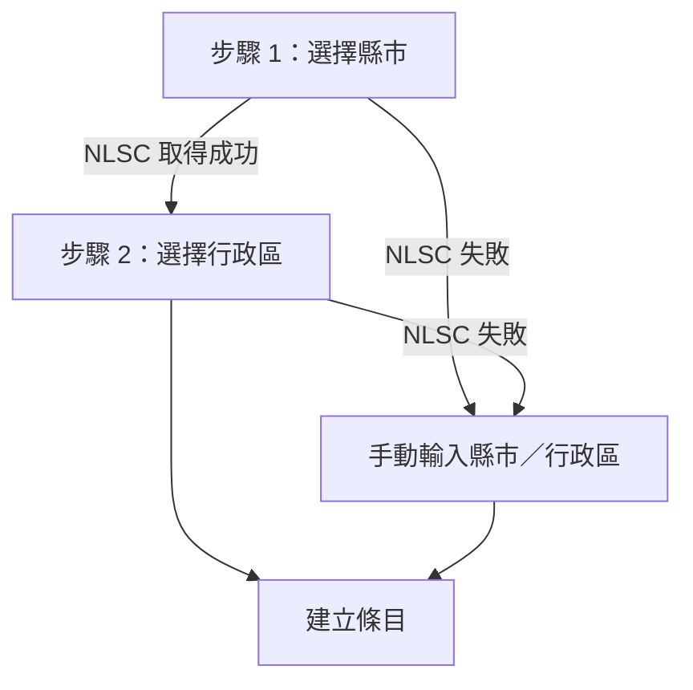

<p align="left">
  
</p>

# 台灣停班停課 – Home Assistant 自訂整合

[English](README.md) | 繁體中文

從 **行政院人事行政總處（DGPA）**「[天然災害停止上班及上課情形](https://www.dgpa.gov.tw/typh/daily/nds.html)」網頁抓取最新公告，為每個你關注的地點（縣市或縣市＋行政區）建立一個 `binary_sensor`，方便在颱風、豪雨期間做自動化通知。

| 項目 | 內容 |
| --- | --- |
| Domain | `tw_suspension` |
| 整合類型 | `service`（雲端輪詢 `cloud_polling`） |
| 平台 | `binary_sensor` |
| 最低 HA 版本 | 2024.11.0 |
| 相依套件 | `beautifulsoup4>=4.12.0`（HA 會自動安裝） |
| 版本 | 0.2.0 |

---

## 功能特色

- **一個地點兩個感測器**：可針對整個縣市，或縣市底下特定行政區建立「今天」與「明天」兩個二元感測器。
- **今天／明天分開判斷**：DGPA 同一格常同時列出「今天…」與「明天…」兩句（也支援「X月X日」寫法），會分別對應到兩個實體。
- **否定句排除**：「未達停止上班及上課標準」不會被誤判為停班。
- **下拉選單選地點**：縣市／行政區清單即時取自 **國土測繪中心（NLSC）代碼服務 API**；API 失敗時自動切換為手動輸入。
- **智慧比對**：自動統一「台／臺」寫法；指定行政區但公告只到縣市層級時，會自動退回使用縣市或「其他地區」的公告。
- **部分時段判斷**：公告中含「上午、下午、晚上、夜間、中午、X 時、HH:MM」等字樣時，`partial` 屬性會標記為 `true`。
- **共用快取**：多個地點共用同一份網頁資料（快取 60 秒），避免重複請求政府網站。
- **斷線容錯**：更新失敗時保留上次已知狀態（`stale` 屬性會變成 `true`）；但若已跨日，舊資料不再可信，實體會變成「無法使用」。
- **可調整更新頻率與 SSL 驗證**：透過整合的「選項」設定，變更後自動重新載入。
- **中英文介面**：內建 `zh-Hant` 與 `en` 翻譯。

---

## 安裝

### 方式一：HACS（建議）

1. HACS → 右上角「⋮」→「自訂儲存庫」。
2. 貼上本專案的 repo URL，類別選 **Integration**。
3. 搜尋「Taiwan Work and School Suspension」並下載。
4. 重新啟動 Home Assistant。

### 方式二：手動安裝

1. 將 `custom_components/tw_suspension` 整個資料夾複製到 HA 的 `/config/custom_components/`。
2. 重新啟動 Home Assistant。

---

## 設定

到「**設定 → 裝置與服務 → 新增整合**」搜尋「**Taiwan Work and School Suspension**」。

### 設定流程



1. **選擇縣市**：下拉選單列出全台縣市。
2. **選擇行政區**：
   - 選「**整個縣市**」：看縣市整體公告（詳見下方判斷邏輯）。
   - 選特定行政區：只看該區的公告。
3. **手動輸入（備援）**：若 NLSC 清單無法取得，會顯示錯誤原因並讓你手動輸入。名稱需與 DGPA 網頁一致，行政區可留空。

> [!NOTE]
> - 每新增一個地點，就再新增一次整合。
> - 同一個「縣市＋行政區」組合只能設定一次（unique ID 為 `縣市|行政區`），重複設定會顯示「此地點已設定過」。
> - 條目名稱為「縣市＋行政區」，例如 `臺北市`、`新北市板橋區`。

### 選項（設定完成後調整）

在整合卡片點「**設定**」：

| 選項 | 預設值 | 範圍 | 說明 |
| --- | --- | --- | --- |
| 更新間隔（分鐘） `scan_interval` | `30` | 10 – 1440 | 多久向 DGPA 抓一次資料 |
| 驗證 SSL 憑證 `verify_ssl` | `false` | 開／關 | DGPA 網站憑證缺少 Subject Key Identifier，嚴格驗證會失敗，因此預設關閉 |

儲存後整合會自動重新載入以套用設定。

---

## 實體說明

每個條目會建立一個裝置（類型為「服務」，製造商標示為「行政院人事行政總處 (DGPA)」）以及兩個二元感測器。

| 實體名稱 | 英文介面 | 代表日期 |
| --- | --- | --- |
| `今天停班停課` | `Work/class suspension today` | 今天 |
| `明天停班停課` | `Work/class suspension tomorrow` | 明天 |

- **實體 ID 範例**：`binary_sensor.臺北市_jin_tian_ting_ban_ting_ke`、`binary_sensor.臺北市_ming_tian_ting_ban_ting_ke`（實際 ID 依 HA 產生規則而定，請至實體列表確認）
- **從舊版升級**：「今天」實體沿用舊版的 unique_id，原本的實體 ID 與自動化不受影響；「明天」為新增實體。

### 狀態

| 狀態 | 條件 | 圖示 |
| --- | --- | --- |
| `on` | `work_stopped` **或** `class_stopped` 為 `true` | `mdi:cloud-alert` |
| `off` | 無停班也無停課，或該日沒有公告（見 `status`） | `mdi:cloud` |
| `unavailable` | 從未成功取得資料，或更新失敗且資料已不是今天的 | — |

### 屬性

| 屬性 | 型別 | 說明 |
| --- | --- | --- |
| `status` | str | 判斷結果，見下表 |
| `work_stopped` | bool | 該日公告停止上班（「未達…標準」不算） |
| `class_stopped` | bool | 該日公告停止上課（含「停止上班及上課」） |
| `partial` | bool | 有停班／停課且只限部分時段（如「下午停止上班」）；整縣市彙整模式下有任一區停班停課即為 `true` |
| `raw` | str | 對應到的原始公告文字（只含該日的句子） |
| `date` | str | 這個實體代表的日期（`YYYY-MM-DD`） |
| `city` | str | 設定的縣市（已統一為「臺」） |
| `district` | str | 設定的行政區（整個縣市時為空字串） |
| `last_updated` | str | 最後成功更新時間（ISO 8601，含時區，精確到秒） |
| `stale` | bool | 最近一次更新失敗、目前顯示的是舊資料 |

`status` 的值：

| 值 | 意思 | 狀態 |
| --- | --- | --- |
| `stopped` | 停班或停課（含已達停班停課標準） | `on` |
| `normal` | 照常上班上課，或未達標準 | `off` |
| `not_listed` | 網頁有公告，但沒有列出這個縣市／行政區 | `off` |
| `not_announced` | 有列出這個縣市，但這一天還沒公告 | `off` |
| `no_announcement` | 全國都沒有停班停課訊息 | `off` |

---

## 運作原理


### 1. 抓取網頁（[api.py](custom_components/tw_suspension/api.py)）

- 以 `aiohttp` 抓取 DGPA 網頁，逾時 10 秒。
- 先以 UTF-8 解碼，失敗則改用 Big5。
- 所有條目共用同一個 `DgpaClient`（依 `verify_ssl` 設定區分），並以鎖＋60 秒快取避免同時重複抓取。
- 網頁抓取失敗，或既解析不到縣市、也沒有「無停班停課訊息」時，拋出 `DgpaError`，由協調器轉為 `UpdateFailed`。

### 2. 解析網頁（[parser.py](custom_components/tw_suspension/parser.py)）

- 將網頁轉純文字後逐行掃描，辨識以縣市名稱開頭的行（可帶「北部地區／中部地區…」前綴），遇到「備註」、「語音查詢電話」等字樣即停止。
- 從頁首的民國日期（如「115年10月23日」）取得網頁日期。
- 每個縣市解析成 `{範圍: [句子, ...]}`，範圍等於縣市名稱時代表全縣市公告，例如：
  - `{"臺北市": ["今天停止上班、停止上課", "明天已達停止上班及上課標準"]}`
  - `{"烏來區": ["今天停止上班"], "其他地區": ["今天照常上班"]}`
- 每句依開頭的「今天／今日」、「明天／明日」或「X月X日」歸到對應的日期；沒寫日期的舊格式視為當天。
- 「未達」等否定句一律不算停班停課。

### 3. 判斷邏輯（`evaluate`）

| 情境 | 判斷方式 |
| --- | --- |
| 網頁顯示「無停班停課訊息」 | `no_announcement`（`off`） |
| 網頁上找不到該縣市 | `not_listed`（`off`） |
| 有該縣市但沒有該日的句子 | `not_announced`（`off`） |
| **有指定行政區** | 依序尋找有該日公告的：該行政區 → 縣市整體 → 「其他地區」 |
| **整個縣市**，且有縣市整體公告 | 使用縣市整體公告 |
| **整個縣市**，只有分區公告 | 排除「其他地區」後，**任一區**停班／停課即為 `on`，`partial` 為 `true`，`raw` 會列出所有分區 |

日期以網頁標示的日期換算：午夜後 DGPA 若尚未換頁，前一天的「明天」會正確對應到今天。實體也會在午夜自動重算。

### 4. 縣市／行政區清單

- 縣市：`https://api.nlsc.gov.tw/other/ListCounty`
- 行政區：`https://api.nlsc.gov.tw/other/ListTown1/{縣市代碼}`
- 政府網站常缺中繼憑證，因此先以 SSL 驗證連線，失敗再以不驗證方式重試（僅讀取公開清單）。

---

## 自動化範例

### 前一晚得知明天停班停課時推播通知

```yaml
automation:
  - alias: 明天停班停課通知
    trigger:
      - platform: state
        entity_id: binary_sensor.xxx_ming_tian_ting_ban_ting_ke
        to: "on"
    action:
      - service: notify.mobile_app_your_phone
        data:
          title: "明天停班停課"
          message: >
            {{ state_attr(trigger.entity_id, 'city') }}{{ state_attr(trigger.entity_id, 'district') }}：
            {{ state_attr(trigger.entity_id, 'raw') }}
```

### 只在「今天停課」時觸發

```yaml
trigger:
  - platform: state
    entity_id: binary_sensor.xxx_jin_tian_ting_ban_ting_ke
    attribute: class_stopped
    to: true
```

### 範本：區分全天或部分時段

```yaml

  {{ '部分時段停班停課' if state_attr('binary_sensor.xxx_jin_tian_ting_ban_ting_ke', 'partial') else '全天停班停課' }}

  正常上班上課

```

---

## 疑難排解

| 現象 | 可能原因與處理 |
| --- | --- |
| 新增整合時直接跳到「手動輸入」 | NLSC API 無法連線，畫面上會顯示錯誤原因；手動輸入與 DGPA 網頁一致的名稱即可 |
| 整合顯示「重試設定中」 | 第一次抓取 DGPA 失敗，HA 會自動重試；請確認 HA 可連到 `www.dgpa.gov.tw` |
| 開啟 SSL 驗證後連線失敗 | DGPA 憑證問題，請在選項中關閉「驗證 SSL 憑證」 |
| 日誌出現「解析不到任何縣市資料」 | DGPA 網頁格式可能已變更，請回報 issue |
| 平常狀態都是 `off`、`status` 為 `no_announcement` | 正常現象：無天然災害時 DGPA 只顯示「無停班停課訊息」 |
| 「明天」實體白天是 `off`、`status` 為 `not_announced` | 正常現象：隔日的公告通常在前一晚 7～10 點發布 |
| 實體過午夜後變成「無法使用」 | 抓取持續失敗，舊資料已不是今天的；請確認 HA 可連到 DGPA |

開啟除錯日誌：

```yaml
logger:
  default: warning
  logs:
    custom_components.tw_suspension: debug
```

---

## 專案結構

```text
custom_components/tw_suspension/
├── __init__.py        # 進入點：建立共用 client 與協調器、轉送平台、選項變更時重新載入
├── api.py             # DGPA 網頁抓取（含快取）與 NLSC 縣市／行政區清單
├── binary_sensor.py   # 停班停課二元感測器
├── config_flow.py     # 設定流程（縣市 → 行政區 / 手動輸入）與選項流程
├── const.py           # 常數：網址、預設值、設定鍵
├── coordinator.py     # DataUpdateCoordinator：定期更新並判斷單一地點
├── parser.py          # 純解析函式（不依賴 HA，方便單元測試）
├── manifest.json
└── translations/
    ├── en.json
    └── zh-Hant.json
hacs.json
```

---

## 免責聲明

本整合僅解析 DGPA 公開網頁，資料可能因網頁格式變更或網路問題而延遲或不正確。**實際停班停課請以行政院人事行政總處及各縣市政府正式公告為準。**

---

## 授權條款 (License)

本專案採用 [MIT License](LICENSE) 授權。
